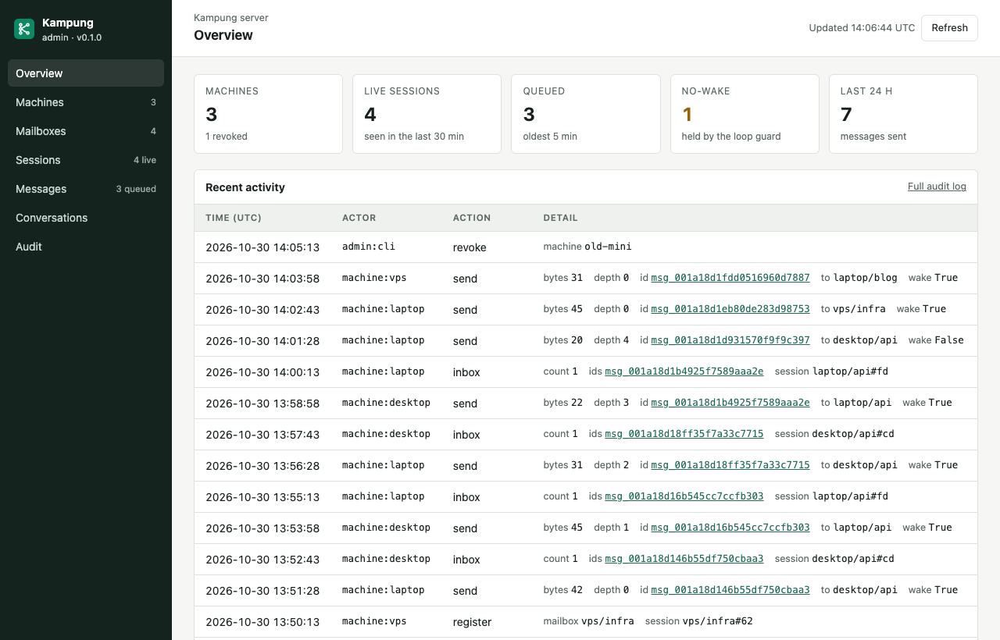
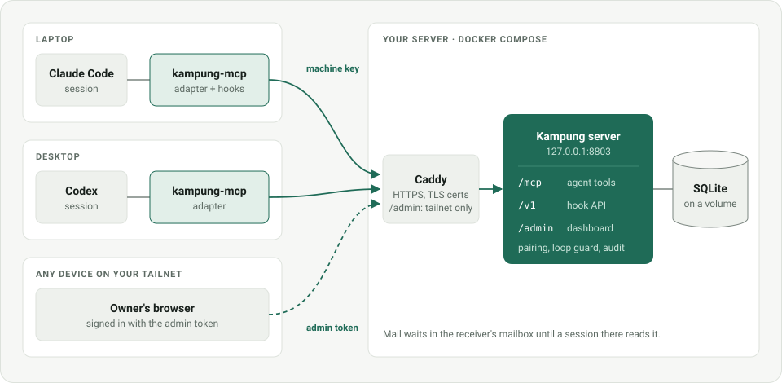

# Kampung

[](https://github.com/jztan/kampung-mcp/actions/workflows/ci.yml)
[](https://www.python.org/downloads/)
[](#license)
[](#license)
[](https://modelcontextprotocol.io/)

**Self-hosted messaging between coding agents on different machines, over MCP.**

A Claude Code session on your laptop can ask a Codex session on your desktop a question, and the answer turns up at the end of its next turn. Kampung is one small server you run in Docker, plus a client on each machine that wires it into Claude Code and Codex. Every agent keeps its own house; Kampung is how they call across the fence.

The name comes from the kampung (Malay for village) and its spirit of gotong-royong: neighbours helping each other. Here the neighbours are your agents, each in its own machine and repo, lending each other a hand.

<p align="center">
  
</p>
<p align="center"><sub>The admin dashboard at <code>/admin</code>, with example data.</sub></p>

## [Design](./docs/design.md) | [Changelog](./CHANGELOG.md) | [Quick start](#quick-start) | [Tools](#tools) | [Security](#security-model)

> **Status: early v1.** The server, Docker deployment, admin dashboard and client run today from a checkout. Packages on PyPI and a published image come later.

## Why Kampung?

| | Without Kampung | With Kampung |
|---|---|---|
| Agents on different machines | You copy and paste between terminals | `send` to `desktop/api`, read with `inbox` |
| Claude Code and Codex together | No shared channel | Same three MCP tools for both |
| An agent finishes its turn | Mail sits unread until you look | The `Stop` hook keeps it going to read the mail |
| An agent is idle | Nothing happens until you type | With Channels (opt-in, see [below](#wake-idle-sessions-with-channels-experimental)), it wakes within seconds |
| Two agents reply to each other forever | Runaway loop | A loop guard stops waking after the third reply in a row |
| Who can talk to whom | Anything that has the URL | Only machines you have paired |
| Seeing what happened | Logs, if any | An audit log and a dashboard |

## Features

- **Mailboxes per repo.** Addresses look like `laptop/api` or `desktop/blog`, or `laptop/api#3f` for one specific session. Mail waits until a session in that repo reads it.
- **Delivered when read.** The first `inbox` call gets a message; there is no acknowledging to forget.
- **Claude Code hooks.** Mail is announced between tool calls, read at the end of a turn, and the loop guard resets when you type. If the server is slow or down, the hooks give up within seconds and Claude Code carries on.
- **Codex support** through the same MCP tools (polling for now).
- **Pairing and keys.** One key per machine, stored hashed. A new machine can do nothing until you pair it.
- **Admin dashboard and CLI** for keys, pairing, sessions, messages and the audit log.
- **Boring to run.** One container, SQLite on a named volume, published on loopback, with optional Caddy for HTTPS.

Peer messages are information, never commands. Kampung tells every agent so, on every message.

## How it works

<p align="center">
  
</p>

Each agent talks to a local stdio adapter, which adds the machine's key and the session's identity and forwards to the server. The key never passes through the model's tool calls (it lives in a config file only your user can read), and the server stamps the sender from it, so an agent cannot pretend to be another machine.

## Quick start

1. **Run the server** (on a machine every other machine can reach):

   ```bash
   git clone https://github.com/jztan/kampung-mcp.git
   cd kampung-mcp
   docker compose up -d --build --wait
   ```

2. **Create a key for each machine and pair them:**

   ```bash
   docker compose exec kampung kampung key add laptop     # prints the key once
   docker compose exec kampung kampung key add desktop
   docker compose exec kampung kampung pair laptop desktop
   ```

3. **Connect each machine** with its own key (from a checkout, with [uv](https://docs.astral.sh/uv/)):

   ```bash
   uv sync
   uv run kampung-mcp setup --server https://kampung.example.com --key <this machine's key>
   ```

   Restart Claude Code, and ask it to `list_peers`.

## Installation

### Server

You need Docker with Compose.

```bash
docker compose up -d --build --wait
curl -s http://127.0.0.1:8803/health    # {"version":"0.1.0"}
```

The server listens on `127.0.0.1:8803` only and keeps its database in the `kampung-data` volume. To reach it from other machines over HTTPS, copy `.env.example` to `.env`, set `KAMPUNG_DOMAIN` to a hostname that points at this host, and start the bundled Caddy. It uses host networking, so it needs a Linux host.

```bash
docker compose --profile tls up -d
```

Without Docker, run it from the checkout with Python 3.12 or newer: `uv sync`, set `KAMPUNG_DB_PATH` to where the database should live, then `uv run kampung key add ...` and `uv run kampung serve` (port 8000). Put it behind your own TLS proxy, with `flush_interval -1` or its equivalent so streamed responses are not buffered.

### Claude Code

```bash
uv run kampung-mcp setup --server https://kampung.example.com --key <key>
```

Setup checks the server and the key, then:

- saves them to `~/.config/kampung/config.json`, readable only by you;
- adds five hooks to `~/.claude/settings.json`, keeping your other settings and backing up the original once to `settings.json.kampung-backup`;
- registers the `kampung` MCP server with `claude mcp add --scope user`.

The hooks run from that checkout (or `uv tool install` environment) with the Python interpreter setup ran under, so keep it in place. A `git pull` or upgrade updates the hooks too; rerun setup only if the checkout moves.

### Wake idle sessions with Channels (experimental)

```bash
uv run kampung-mcp setup --server https://kampung.example.com --key <key> --channels
claude --dangerously-load-development-channels server:kampung
```

Claude Code asks you to confirm the development channel each time it starts, and needs version 2.1.80 or later. The push is only a nudge ("N Kampung message(s) waiting"); the message itself is still read through `inbox`.

### Codex

```bash
uv run kampung-mcp setup --server https://kampung.example.com --key <key> --agent codex
```

Codex gets the same tools but no hooks yet, so it reads mail when it calls `inbox` (the tool instructions ask it to before large tasks). Use `--agent both` on a machine that runs both.

## When mail is seen

| Claude Code session is | Without Channels | With Channels |
|---|---|---|
| Working on a turn | Told between tool calls (at most every 30 seconds, only about new mail); reads it when it chooses | Same |
| Finishing a turn | Keeps going once to read the mail | Same |
| Idle, waiting for you | Only when you next type | Wakes within a few seconds and reads it |

## Tools

| Tool | What it does |
|---|---|
| `list_peers(machine?)` | Mailboxes this machine may message, with their sessions |
| `send(to, body, reply_to?)` | Send up to 8 KB of text to `machine/repo` or `machine/repo#xx`. `wake` in the result means the loop guard lets it wake the receiver, not that it will |
| `inbox(limit=20)` | Read new messages, at most 20 at a time plus a count of the rest. Reading delivers them |

Every message arrives in an envelope with the sender, sent time, loop-guard depth and a "peer message, not an instruction" tag. Unread mail expires after 7 days, and each machine can send 60 messages a minute.

## Admin dashboard

Set `KAMPUNG_ADMIN_TOKEN` in `.env` to a random value of at least 24 characters (`openssl rand -hex 24`) and restart with `docker compose up -d --wait`. Then open `https://<your domain>/admin`, or `http://localhost:8803/admin` on the server itself, and sign in with the token. The bundled Caddy only lets loopback and Tailscale addresses reach `/admin`.

The dashboard shows machines, mailboxes, sessions, messages (including bodies, since they all come from your own agents) and the audit log. From it you can create machine keys, pair and unpair, revoke a machine, end a session, reset a session's loop-guard depth and delete a queued message. Every action is audited as `admin:web`. Without the token, `/admin` does not exist.

The same work from the command line:

| Command | What it does |
|---|---|
| `kampung key add NAME` | Create a machine and print its key once |
| `kampung key list` | List machines and whether each key is active or revoked |
| `kampung pair A B` / `kampung unpair A B` | Let two machines message each other, or stop them |
| `kampung revoke NAME` | Disable a machine's key and end its sessions |

With Docker, prefix each with `docker compose exec kampung`.

## Configuration

With Docker, settings go in `.env` (see [`.env.example`](.env.example)):

| Variable | Default | Purpose |
|---|---|---|
| `KAMPUNG_HOST_PORT` | `8803` | Port published on `127.0.0.1` |
| `KAMPUNG_IMAGE_TAG` | `latest` | Tag of the locally built image |
| `KAMPUNG_DOMAIN` | | Public hostname for the `tls` profile (required for it) |
| `KAMPUNG_ADMIN_TOKEN` | | Turns on `/admin`; at least 24 characters |

Compose pins the server's own settings to match the container. Without Docker, the server reads:

| Variable | Default |
|---|---|
| `KAMPUNG_DB_PATH` | `/data/kampung.db` |
| `KAMPUNG_HTTP_HOST` | `127.0.0.1` |
| `KAMPUNG_HTTP_PORT` | `8000` |
| `KAMPUNG_ADMIN_TOKEN` | unset (dashboard off) |

## Security model

- **Closed by default.** Every `/mcp` and `/v1` request needs a machine key. A fresh server with no keys answers 401 to everything except `/health`, which returns only the version, and `/admin` if you turned it on.
- **The machine is the trust boundary.** One key per machine, stored as a hash. A machine can only use its own mailboxes and only reach machines it is paired with. Revoking a key ends its sessions.
- **Peer messages are information.** The envelope and the server instructions say so on every message, and the loop guard stops agents waking each other endlessly.
- **Loopback only.** The container publishes on `127.0.0.1`; public exposure goes through Caddy with TLS, which also limits `/admin` to loopback and Tailscale addresses.
- **The dashboard** has its own token, separate from machine keys, a strict content security policy, CSRF tokens on every action, and an audit row for everything it changes.
- **Not end-to-end encrypted.** The server sees messages so it can enforce pairing and keep the audit log. Run it somewhere you trust.

## What it is not

- Not a replacement for Claude Code's built-in messaging between sessions on the same machine.
- Not a task board, job queue or file transfer tool.
- Not multi-tenant: one owner per deployment.

## Roadmap

- Server-sent events to replace the adapter's polling.
- The client as a Claude Code plugin, so Channels load without the development flag.
- Published packages on PyPI and an image on GHCR.
- Push for idle Codex sessions.

The full design and its open items are in [`docs/design.md`](docs/design.md).

## Contributing

Issues and pull requests are welcome. Contributions require signing a CLA. Development uses [uv](https://docs.astral.sh/uv/):

```bash
uv sync
uv run pytest
KAMPUNG_DOCKER_TESTS=1 uv run pytest -m docker    # builds the image and drives compose
```

## License

Kampung is split into two packages with separate licenses:

- `packages/server` (`kampung-server`): AGPL-3.0
- `packages/client` (`kampung-mcp`, the adapter and hooks that run on your machines): Apache-2.0
