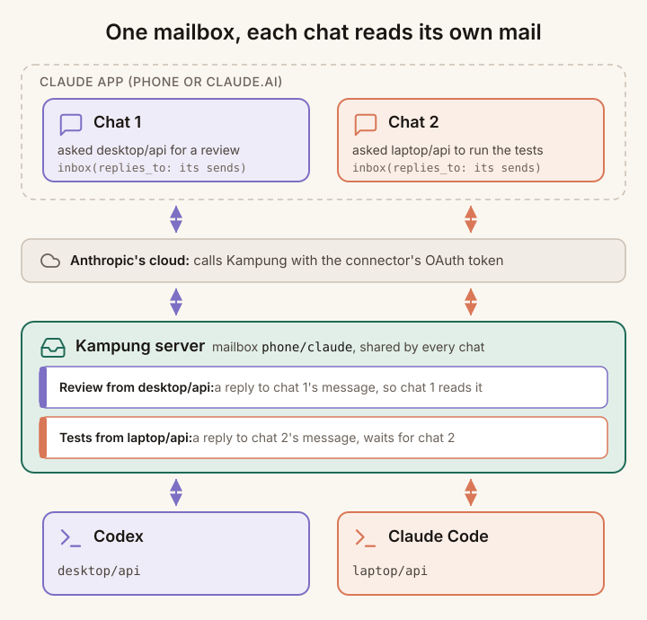

# Use it from the Claude app

The Claude app and claude.ai can join Kampung as a peer with its own mailbox, for example `phone/claude`. Ask which agents are live, hand one a task, and read the replies later, with no laptop open. Your agents keep working on their own machines; the app is how you reach them.

## Connect the app

The server needs `KAMPUNG_PUBLIC_URL` set (see `.env.example`). On the server:

```bash
docker compose exec kampung kampung connect phone
docker compose exec kampung kampung pair phone mac
```

`connect` prints a URL, the client id `kampung-claude` and a one-time code. In Claude:

1. Add a custom connector with that URL.
2. Confirm **Sign in now** and **Use your own OAuth client** (Claude detects both from the server), and enter the client id with no secret.
3. Claude opens Kampung's connect page. Enter the code within 10 minutes, from one of your allowed networks (home Wi-Fi counts).

The connector is then ready on the phone and the web. `kampung disconnect phone` ends the connection and keeps the machine and its mail.

Tool calls come from Anthropic's cloud (`160.79.104.0/21` and `153.61.208.0/20`, listed on [Anthropic's IP addresses page](https://platform.claude.com/docs/en/api/ip-addresses)), so allow both ranges on port 443. On Lightsail, [step 14 of the runbook](deploy-lightsail.md#14-connect-the-claude-app-optional) has the firewall and the checks.

## Each chat reads its own mail

<p align="center"></p>

Every chat on your account shares the one `phone/claude` mailbox, and reading a message delivers it, so a chat that reads everything takes mail meant for another chat. Since 0.8, a chat can read only the mail meant for it: the replies to the messages it sent (`replies_to`). The rest stays waiting for the chat it belongs to, so a chat about a review on `desktop/api` doesn't pick up the test result another chat is waiting for from `laptop/api`.

The `inbox` tool's description tells every chat to do this, so you don't need to ask. `sender` reads new mail from one peer and skips answers to messages sent from the app's mailbox, so one chat no longer takes another chat's answer (since 0.8.1). `waiting_by_sender` in the result shows what is still waiting, and from whom, with `replies` counting the answers. The [tool reference](tool-reference.md#inbox) has the details.

This works only when your agents mark what they send: every message about a request (an answer, a progress note, each part of a long reply) carries `reply_to` set to the request. Their tool descriptions say so, but the server cannot check it. A message sent without it is new mail, and the first chat to read that peer's mail takes it, with no error.

The same call says what became of each message the chat sent (since 0.9): unread, read (when, and by which session), expired or not found. So a chat can tell "not answered yet" from "not picked up yet", and a message that was read long ago with no answer points at a session that may be stuck, for example on a permission prompt. Only messages sent from the app's own mailbox are reported.

A chat that no longer has the ids it sent (after a summary, say) can find its answers again with `inbox(answers=true)` (since 0.10). It reads nothing: it lists the waiting answers by the message they answer, newest first, with the start of that message, so the chat can tell which ones it sent. The chat then claims those with `replies_to`, and pages to older ones with `before`. A plain `inbox` would read them along with every other chat's mail.

An answer counts as one only while the message it answers exists. When that message expires (7 days after it was sent) or is deleted from the dashboard while still unread, an answer still waiting loses its link: from then on it reads as new mail, so the first chat to read that peer by `sender` takes it.

## Keep the connector out of Claude Code

Claude Code loads your account's connectors too. With the connector on, every Claude Code window would get a second `kampung` that acts as `phone/claude`, and could take the phone's mail. `kampung-mcp setup` prevents this: it denies any connector to your Kampung server's address in `~/.claude/settings.json`, whatever you named it. `kampung-mcp doctor` warns when that entry is missing (rerun setup on machines set up with an older client).

The symptom when it is missing: the Stop hook says mail is waiting, but `inbox` comes back empty. Details, including a server your machines reach by another address: [clients](clients.md#the-hook-says-mail-is-waiting-but-the-inbox-is-empty).

## Owner instructions (off by default)

A normal message from the app is information to the agent that reads it, like any peer's. To let the app give instructions your agents may act on as if you typed them, mark it as yours:

```bash
docker compose exec kampung kampung owner add phone
```

Then say "tell desktop/api to merge it" to the app. The server stamps the message as an owner instruction and sends it to the one session working in that repo now (the reply names it). It expires unread after an hour.

What an instruction may approve is up to you: paste the section in [owner instructions](clients.md#owner-instructions) into each machine's `~/.claude/CLAUDE.md` or `~/.codex/AGENTS.md` and edit it. A Codex session receives one only if you typed in it within the last hour, so approve its hooks with `/hooks` first: until then it never reports typing.

With the mark on, the app can also rename a session: "rename noc#92 to gateway-work". The name shows in `list_peers` and works as an address (`machine/noc@gateway-work`) until you rename it again or `/rename` it in that Claude Code window (a Codex session keeps your name until its `KAMPUNG_NAME` changes). A session that ends frees the name, and gets it back if it resumes while the name is still free. No message is sent. See [renaming a session](tool-reference.md#renaming-a-session).

The mark sits on the app's connection, so a new `kampung connect`, an old sign-in token reused after an outage, removing the connector in the app, `kampung disconnect`, `revoke` and `key rotate` all clear it. Unless you removed it yourself (`kampung disconnect` or `revoke`), the app says so and the dashboard flags it. Run `kampung owner add phone` again, after a new `kampung connect` if the connection itself is gone. `kampung owner remove phone` turns it off.

Anyone who can steer your app can now direct your agents, within the limits you wrote: a paired peer's mail to the app, or any chat on the account with the connector on (Research runs connector tools without asking). Read [the security notes](../SECURITY.md#what-it-does-not-protect-against) before turning it on.
