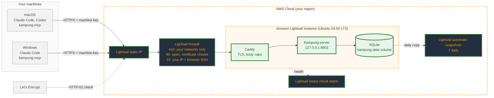

# Deploy on Amazon Lightsail

A runbook for one Kampung server on an Amazon Lightsail instance, reached over public HTTPS from a short list of networks. It uses only AWS and the repo: no other hosted service.

Plan for about an hour and about $5.40 a month: the $5 Lightsail plan plus a few cents of snapshots. You need:

- an AWS account;
- a domain you control, for the HTTPS certificate (for example `kampung.example.com`);
- the public IPv4 address of every network your machines connect from. On each network, `curl https://checkip.amazonaws.com` prints it.

## What you build



Legend: **dark boxes with orange text** are AWS resources you create, **green boxes** are the software you deploy, and **grey boxes** already exist. A green border marks everything new in this runbook.

## 1. Create the instance

In the [Lightsail console](https://lightsail.aws.amazon.com/), choose **Create instance**:

- **Region:** the one closest to where you work. Kampung's hooks give up after 2 seconds, so latency matters more than price.
- **Platform and blueprint:** Linux/Unix, **OS Only**, **Ubuntu 24.04 LTS**.
- **SSH key pair:** create one or upload your own public key.
- **Plan:** **Nano, 0.5 GB with public IPv4** ($5/month). Running, the Kampung container uses about 100 MB and Caddy about 50 MB, so the whole server fits in roughly 400 MB. Building the image needs more, which the swap file in step 6 covers. Skip the IPv6-only plans: they can't take a static IP, and many networks still can't reach IPv6.
- **Name:** for example `kampung`.

Ubuntu installs security updates on its own (`unattended-upgrades` is on by default).

## 2. Give it a static IP

**Networking → Create static IP**, attach it to the instance. A static IP keeps your DNS record valid across stops, and lets you move the address to a restored instance (step 13).

## 3. Lock down the firewall

On the instance's **Networking** tab, set the **IPv4 firewall** to exactly these rules:

| Application | Port | Source |
|---|---|---|
| HTTPS | 443 | **Restrict to IP address**: each of your networks, one rule per address |
| HTTP | 80 | All IP addresses |
| SSH | 22 | **Restrict to IP address**: your home address, and tick **Allow Lightsail browser SSH/RDP** |

Why port 80 stays open: Let's Encrypt checks domain ownership over plain HTTP from addresses that aren't published, so Caddy can't get a certificate if port 80 is restricted. Port 80 only answers those checks and redirects everything else to HTTPS. Kampung's client refuses plain `http://`, so it never sends a key there.

**IPv6:** the IPv6 firewall has its own rules. Either turn IPv6 off for the instance (**Networking → IPv6**), or give the IPv6 firewall the same three rules. Don't leave the defaults, which let SSH in from anywhere.

## 4. Turn on automatic snapshots

**Snapshots → Automatic snapshots → Enable.** Lightsail keeps the latest seven daily snapshots and deletes them when you delete the instance; copy one to a manual snapshot to keep it longer.

Snapshots hold everything on the disk, including unread messages (up to 7 days) and the audit log. Lightsail documents encryption at rest for **attached disks and disk snapshots**. If you want that promise for the database itself, attach a small disk (**Storage → Create disk**), mount it, and set Docker's `data-root` to it before step 6.

## 5. Point your domain at it

At your DNS provider, add an `A` record: `kampung.example.com` → the static IP. Lightsail's own DNS zones work too (**Domains & DNS**). Wait until `dig +short kampung.example.com` returns the static IP.

## 6. Add swap and install Docker

Connect with SSH (`ssh -i <key> ubuntu@<static IP>`) or the browser SSH in the console. First give the 0.5 GB plan a 2 GB swap file, so building the image can't run out of memory:

```bash
sudo fallocate -l 2G /swapfile
sudo chmod 600 /swapfile
sudo mkswap /swapfile && sudo swapon /swapfile
echo '/swapfile none swap sw 0 0' | sudo tee -a /etc/fstab
free -h    # Swap: 2.0Gi
```

Then Docker:

```bash
curl -fsSL https://get.docker.com | sudo sh
sudo usermod -aG docker ubuntu
exit    # log back in so the group applies
docker compose version
```

## 7. Get the code

The repository is private, so give the instance a read-only deploy key:

```bash
ssh-keygen -t ed25519 -N "" -f ~/.ssh/kampung_deploy
cat ~/.ssh/kampung_deploy.pub
```

On GitHub: **Settings → Deploy keys → Add deploy key**, paste it, leave **Allow write access** off. Then:

```bash
cat >> ~/.ssh/config <<'EOF'
Host github.com
  IdentityFile ~/.ssh/kampung_deploy
EOF
git clone git@github.com:jztan/kampung-mcp.git
cd kampung-mcp
```

## 8. Configure

```bash
cp .env.example .env
chmod 600 .env
nano .env    # set KAMPUNG_DOMAIN=kampung.example.com
```

Leave `KAMPUNG_ADMIN_TOKEN` unset unless you want the dashboard (step 11).

## 9. Start it

```bash
docker compose --profile tls up -d --build --wait
docker compose logs caddy | grep -i certificate    # "certificate obtained successfully"
```

From one of your allowed networks:

```bash
curl https://kampung.example.com/health    # {"version":"0.1.0"}
```

From anywhere else, the same command should time out: the firewall drops it.

## 10. Add machines and pair them

On the instance:

```bash
docker compose exec kampung kampung key add mac
docker compose exec kampung kampung key add windows
docker compose exec kampung kampung pair mac windows
```

Each key is printed once. Copy it straight into the machine it belongs to; don't paste it into chat, tickets or notes.

On each machine, from a checkout of the client:

```bash
uv sync
uv run kampung-mcp setup --server https://kampung.example.com
```

Setup asks for the key without showing it. Restart Claude Code and ask it to `list_peers`.

**If setup or the first tool call fails with a certificate error**, the network in between is inspecting TLS with its own certificate authority. Set `SSL_CERT_FILE` to a bundle that includes it; the hooks and the adapter both honour it. Set it where Claude Code starts from, so its child processes inherit it: your shell profile on macOS, or `setx SSL_CERT_FILE C:\path\to\bundle.pem` on Windows (then open a new terminal).

## 11. Use the dashboard (optional)

Set `KAMPUNG_ADMIN_TOKEN` in `.env` (`openssl rand -hex 24`), then `docker compose --profile tls up -d --wait`. Caddy only serves `/admin` to loopback, so reach it through an SSH tunnel instead of opening it to the internet:

```bash
ssh -i <key> -L 8803:127.0.0.1:8803 ubuntu@<static IP>
```

Then open `http://localhost:8803/admin` on your own machine and sign in with the token.

## 12. Get told when it breaks

**Metrics → Status check failures → Add alarm**, with an email notification contact. Kampung's hooks fail open, so a dead server shows up as mail that never arrives, not as an error. The alarm is how you find out.

## 13. Day-to-day operations

| Task | How |
|---|---|
| Upgrade | `git pull && docker compose --profile tls up -d --build --wait` |
| Need more memory | Create a new instance from a snapshot on the 1 GB plan ($7/month), move the static IP to it, check `/health` |
| A network's address changed | Edit its HTTPS rule in step 3. Until then, clients there time out quietly. |
| A machine or key is lost | `docker compose exec kampung kampung revoke <name>` (ends its sessions too) |
| Restore | Create a new instance from a snapshot, move the static IP to it, check `/health` |
| Logs | `docker compose logs --tail 100 kampung` (capped at 3 x 10 MB per service) |
| Tear down | Delete the instance (its automatic snapshots go with it), then the static IP, which is billed while unattached |

See [SECURITY.md](../SECURITY.md) for the threat model and the full list of limits.
