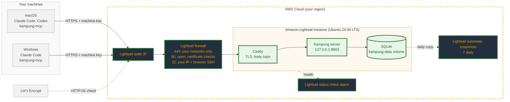

# Deploy on Amazon Lightsail

A runbook for one Kampung server on an Amazon Lightsail instance, reached over public HTTPS from a short list of networks. It uses AWS, the repo, and Let's Encrypt for the free HTTPS certificate: no other hosted service.

Plan for about an hour and about $5.40 a month: the $5 Lightsail plan plus about 30 to 40 cents of snapshots. You need:

- an AWS account;
- a domain you control, whose DNS records you can edit. You'll use one name under it for the server, for example `kampung.example.com`; the HTTPS certificate is issued for that name (step 9);
- the public IPv4 address of every network your machines connect from. On each network, `curl https://checkip.amazonaws.com` prints it.

## What you build



Legend: **dark boxes with orange text** are AWS resources you create, **green boxes** are the software you deploy, and **grey boxes** already exist. A green border marks everything new in this runbook.

## 1. Create the instance

In the [Lightsail console](https://lightsail.aws.amazon.com/), choose **Create instance**:

- **Region:** the one closest to where you work. Kampung's hooks give up after 2 seconds, so latency matters more than price.
- **Platform and blueprint:** Linux/Unix, **OS Only**, **Ubuntu 24.04 LTS**.
- **SSH key pair:** create one or upload your own public key. Give it a name of its own, such as `kampung-key`: in a test run, a key pair called `kampung` made Lightsail reject an instance called `kampung` ("Some names are already in use").
- **Plan:** **Nano, 0.5 GB with public IPv4** ($5/month). Ubuntu reports about 410 MB of it as usable and uses about 200 MB itself, which leaves room for Kampung (about 100 MB) and Caddy (about 50 MB), with idle pages moving to swap. Building the image needs more: in a test run it pushed about 210 MB into the swap file from step 6, so don't skip that step. Skip the IPv6-only plans: they can't take a static IP, and many networks still can't reach IPv6.
- **Name:** for example `kampung`.

Ubuntu installs security updates on its own (`unattended-upgrades` is on by default).

## 2. Give it a static IP

**Networking → Create static IP**, attach it to the instance. A static IP keeps your DNS record valid across stops, and lets you move the address to a restored instance (step 13).

## 3. Lock down the firewall

On the instance's **Networking** tab, set the **IPv4 firewall** to exactly these rules:

| Application | Port | Source |
|---|---|---|
| HTTPS | 443 | **Restrict to IP address**: the address of each of your networks (one rule can list several) |
| HTTP | 80 | All IP addresses |
| SSH | 22 | **Restrict to IP address**: your own network's IP address, and tick **Allow Lightsail browser SSH/RDP** |

Why port 80 stays open: Let's Encrypt checks domain ownership over plain HTTP from addresses that aren't published, so Caddy can't get a certificate if port 80 is restricted. Port 80 only answers those checks and redirects everything else to HTTPS. Kampung's client refuses plain `http://`, so it never sends a key there.

**IPv6:** the IPv6 firewall has its own rules. Either turn IPv6 off for the instance (**Networking → IPv6**), or give the IPv6 firewall the same three rules. Don't leave the defaults, which let SSH in from anywhere.

## 4. Turn on automatic snapshots

**Snapshots → Automatic snapshots → Enable.** Lightsail keeps the latest seven daily snapshots and deletes them when you delete the instance; copy one to a manual snapshot to keep it longer.

Snapshots hold everything on the disk, including unread messages (up to 7 days) and the audit log. Lightsail [documents encryption at rest](https://docs.aws.amazon.com/lightsail/latest/userguide/amazon-lightsail-faq-block-storage.html) for **attached disks and disk snapshots**. If you want that promise for the database itself, attach a small disk (**Storage → Create disk**) now, and see the note in step 6.

## 5. Point your domain at it

Pick the name your machines will use, usually a subdomain such as `kampung.example.com`. It goes into three places: the DNS record below, `KAMPUNG_DOMAIN` in step 8 (which tells Caddy what to get a certificate for), and every machine's `setup --server` in step 10. Changing it later means a new certificate and running setup again on every machine.

Create an `A` record for that name pointing at the static IP:

- **Route 53:** **Hosted zones →** your domain **→ Create record**. Record name `kampung`, type `A`, value the static IP, TTL `300`.
- **Lightsail DNS zones:** **Domains & DNS →** your zone **→ Add record**, type `A`.
- **Any other DNS provider:** an `A` record for the name, with the static IP as its value.

A short TTL (300 seconds) means a restored server (step 13) is reachable again within minutes of moving the record. Leave out an `AAAA` (IPv6) record: the firewall allows nothing over IPv6.

If your domain has `CAA` records, they must allow Let's Encrypt (`0 issue "letsencrypt.org"`), or the certificate in step 9 is refused. Most domains have none, which allows any certificate authority.

Wait until the name resolves before step 9, so the first certificate request doesn't fail:

```bash
dig +short kampung.example.com    # the static IP
```

## 6. Add swap and install Docker

Connect with SSH (`ssh -i <key> ubuntu@<static IP>`) or the browser SSH in the console.

If you attached a disk in step 4, format and mount it first (add it to `/etc/fstab` with `nofail`), and write `{"data-root": "<mount point>/docker"}` to `/etc/docker/daemon.json` *before* installing Docker, so Docker keeps its volumes, including the database, on that disk from the start.

Give the 0.5 GB plan a 2 GB swap file, so building the image can't run out of memory:

```bash
sudo fallocate -l 2G /swapfile
sudo chmod 600 /swapfile
sudo mkswap /swapfile && sudo swapon /swapfile
echo '/swapfile none swap sw 0 0' | sudo tee -a /etc/fstab
free -h    # Swap: 2.0Gi
```

Then Docker:

```bash
curl -fsSL https://get.docker.com | sudo sh
sudo usermod -aG docker ubuntu
exit    # then reconnect, so the docker group applies
```

After reconnecting:

```bash
docker compose version
```

## 7. Get the code

If the repository is public, clone it over HTTPS and skip to step 8:

```bash
git clone https://github.com/jztan/kampung-mcp.git
cd kampung-mcp
```

While it is private, give the instance a read-only deploy key instead:

```bash
ssh-keygen -t ed25519 -N "" -f ~/.ssh/kampung_deploy
cat ~/.ssh/kampung_deploy.pub
```

On GitHub: **Settings → Deploy keys → Add deploy key**, paste it, leave **Allow write access** off. Or, from a machine where `gh` is signed in, save the key to a file and run this as one line (it adds a read-only key unless you pass `--allow-write`):

```bash
gh repo deploy-key add kampung_deploy.pub --repo jztan/kampung-mcp --title "kampung-server"
```

Then, on the instance:

```bash
cat >> ~/.ssh/config <<'EOF'
Host github.com
  IdentityFile ~/.ssh/kampung_deploy
EOF
git clone git@github.com:jztan/kampung-mcp.git    # answer yes to GitHub's host key
cd kampung-mcp
```

## 8. Configure

```bash
cp .env.example .env
chmod 600 .env
nano .env    # set KAMPUNG_DOMAIN=kampung.example.com
```

Leave `KAMPUNG_ADMIN_TOKEN` unset unless you want the dashboard (step 11).

## 9. Start it

```bash
docker compose --profile tls up -d --build --wait    # about 80 s on the Nano plan
docker compose logs -f caddy    # wait for "certificate obtained successfully", then Ctrl-C
```

From one of your allowed networks:

```bash
curl -m 5 https://kampung.example.com/health    # {"version":"0.1.0"}
```

From anywhere else, the same command should time out: the firewall drops it. The instance itself is a handy "anywhere else": run the same `curl -m 5` there, and it should time out after 5 seconds (without `-m`, curl waits about two minutes), because the request arrives from the instance's own address, which isn't on the list.

### The HTTPS certificate

There's nothing to buy or upload. On its first start, Caddy asks Let's Encrypt for a free certificate for `KAMPUNG_DOMAIN`:

1. Let's Encrypt fetches a one-time token from `http://kampung.example.com/.well-known/acme-challenge/...`, from several servers whose addresses aren't published. That's why port 80 stays open to everyone in step 3.
2. The certificate is issued and saved in the `caddy-data` volume, so restarts and upgrades reuse it.
3. Caddy renews it on its own, about 30 days before it expires (certificates last 90 days). Renewals repeat the port 80 check, so never close port 80.

Check which certificate is being served, and until when:

```bash
echo | openssl s_client -connect kampung.example.com:443 -servername kampung.example.com 2>/dev/null \
  | openssl x509 -noout -issuer -enddate    # issuer ... Let's Encrypt, notAfter=...
```

If `docker compose logs caddy` shows `could not get certificate` instead, the cause is almost always one of these:

| Cause | Fix |
|---|---|
| The name doesn't resolve to the static IP yet | Wait for `dig` (step 5), then `docker compose --profile tls restart caddy` |
| Port 80 is closed or restricted | Open it to all IP addresses (step 3) |
| A `CAA` record doesn't allow Let's Encrypt | Add `0 issue "letsencrypt.org"` (step 5) |
| Too many attempts | Let's Encrypt limits repeated certificates for the same name to a few per week. Fix the cause, then wait; don't delete `caddy-data` to retry, which uses up the limit faster |

## 10. Add machines and pair them

On the instance:

```bash
docker compose exec kampung kampung key add mac
docker compose exec kampung kampung key add windows
docker compose exec kampung kampung pair mac windows
```

With more than two machines, pair every two that should talk (three machines need three `pair` commands). Each key is printed once. Copy it straight into the machine it belongs to; don't paste it into chat, tickets or notes.

On each machine, install [uv](https://docs.astral.sh/uv/getting-started/installation/), get the repo (same as step 7: HTTPS once it's public; while it's private, the machine needs its own GitHub access), then:

```bash
uv sync
uv run kampung-mcp setup --server https://kampung.example.com
```

Setup asks for the key without showing it. Restart Claude Code and ask it to `list_peers`. For Codex, add `--agent codex` (or `--agent both`) and approve the hooks once in Codex with `/hooks`; the README's Codex section has the details.

**If setup or the first tool call fails with a certificate error**, the network in between is inspecting TLS with its own certificate authority. Set `SSL_CERT_FILE` to a bundle that includes it; the hooks and the adapter both honour it. Set it where Claude Code starts from, so its child processes inherit it: your shell profile on macOS, or `setx SSL_CERT_FILE C:\path\to\bundle.pem` on Windows (then open a new terminal).

## 11. Use the dashboard (optional)

Set `KAMPUNG_ADMIN_TOKEN` in `.env` (`openssl rand -hex 24`), then `docker compose --profile tls up -d --wait`. Caddy only serves `/admin` to loopback and the Tailscale address range, so on Lightsail reach it through an SSH tunnel instead of opening it to the internet:

```bash
ssh -i <key> -L 8803:127.0.0.1:8803 ubuntu@<static IP>
```

Then open `http://localhost:8803/admin` on your own machine and sign in with the token (`grep KAMPUNG_ADMIN_TOKEN .env` on the instance shows it).

## 12. Get told when it breaks

**Metrics → Status check failures → Add alarm**, with an email notification contact. Kampung's hooks fail open, so a dead server shows up as mail that never arrives, not as an error.

This alarm only covers the instance itself: it fires when the machine or its network is down. It won't notice a stopped container, an expired certificate or a stale firewall rule. For those, check `curl -m 5 https://kampung.example.com/health` now and then from an allowed network, or schedule it there and alert on failure.

- Lightsail sends a verification email first. Its link opens a page with a **Confirm Subscription** button; the email isn't verified until you press it.
- The metric is checked in 5-minute periods. Alarming on 2 of 2 periods means a reboot doesn't email you, and a real outage does after about 10 minutes.
- **Test alarm** on the alarm (or `aws lightsail test-alarm`) sends a sample email, so you know it reaches you.

## 13. Day-to-day operations

| Task | How |
|---|---|
| Upgrade | `cd ~/kampung-mcp && git pull && docker compose --profile tls up -d --build --wait` |
| Need more memory | Same as Restore, but pick the 1 GB plan ($7/month) for the new instance |
| A network's address changed | Edit its HTTPS rule in step 3. Until then, clients there time out quietly. |
| A machine is lost | `docker compose exec kampung kampung revoke <name>` (ends its sessions too) |
| A key leaked | `docker compose exec kampung kampung key rotate <name>`, then `uv run kampung-mcp set-key` on that machine and paste the new key. The name, mailboxes and pairings stay; the old key stops working and its sessions end |
| Restore | Copy an automatic snapshot to a manual one first (deleting an instance deletes its automatic snapshots). Create a new instance from it, then **redo steps 3, 4 and 12**: firewall rules, automatic snapshots and the alarm don't carry over, and a new instance starts with SSH open to everyone. Move the static IP to it, check `/health`, then delete the old instance |
| Logs | `docker compose logs --tail 100 kampung` (capped at 3 x 10 MB per service) |
| Tear down | Delete the instance (its automatic snapshots go with it), then the static IP, which is billed while unattached |

See [SECURITY.md](../SECURITY.md) for the threat model and the full list of limits.
