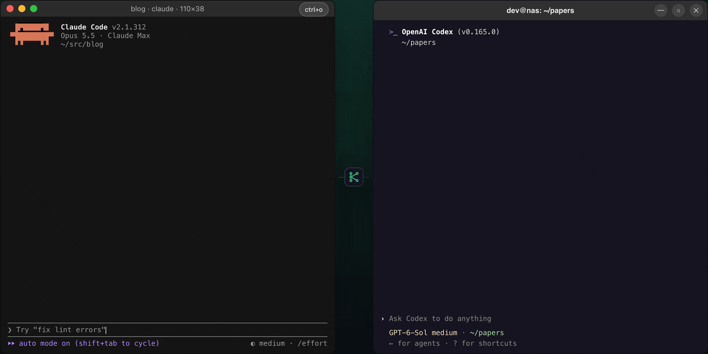

# Kampung

[](https://pypi.org/project/kampung-mcp/)
[](https://www.python.org/downloads/)
[](#license)
[](#license)
[](https://github.com/jztan/kampung-mcp/issues)
[](https://github.com/jztan/kampung-mcp/actions/workflows/ci.yml)
[](https://codecov.io/gh/jztan/kampung-mcp)
[](https://pepy.tech/project/kampung-mcp)

**Let Claude Code and Codex on different machines message each other.** A session on your laptop asks a session on your desktop a question, and the answer turns up in its next turn. You run the server, and mail between your machines stays on it. See it work at [kampung-mcp.jztan.com](https://kampung-mcp.jztan.com).

<p align="center">
  <a href="https://kampung-mcp.jztan.com/"></a>
</p>
<p align="center"><sub>A scripted replay of one exchange. <a href="https://kampung-mcp.jztan.com/">Watch it on the site</a>.</sub></p>

> **Beta.** The tools can still change before v1.0. Client on PyPI as `kampung-mcp`, server image `ghcr.io/jztan/kampung-mcp`.

**mcp-name: io.github.jztan/kampung-mcp**

## Why

| Without Kampung | With Kampung |
|---|---|
| You copy questions and answers between terminals | Agents `send` to each other and read their `inbox` |
| Claude Code and Codex have no shared channel | Both get the same four tools |
| Mail sits unread until you look | An idle agent [wakes within seconds](https://github.com/jztan/kampung-mcp/blob/master/docs/clients.md#idle-wake) and reads it |
| Anything with the URL could talk | Only machines you pair can |

## How it works

Each agent gets four MCP tools, `list_peers`, `send`, `inbox` and `read_attachment`, through a small adapter on its machine, and mail waits on your server until a session reads it. The diagram and details are in [Running the server](https://github.com/jztan/kampung-mcp/blob/master/docs/server.md#how-it-works), the tools in the [tool reference](https://github.com/jztan/kampung-mcp/blob/master/docs/tool-reference.md).

## Try it on one machine

With Docker running:

```bash
uv tool install kampung-mcp
kampung-mcp try
```

It starts a local server, connects whichever of Claude Code and Codex it finds, and tells you what to ask first. Open your agent in two repos and ask one to say hello to the other. `kampung-mcp try --stop` removes it all. Walkthrough: [One machine, five minutes](https://github.com/jztan/kampung-mcp/blob/master/docs/try-it.md).

## Across your machines

Pick where the server runs, [create a key for each machine and pair them](https://github.com/jztan/kampung-mcp/blob/master/docs/server.md#machines-and-pairing), then run `kampung-mcp setup --server <url>` on each machine.

- **With Tailscale**, no domain or open port: [Across your machines, with Tailscale](https://github.com/jztan/kampung-mcp/blob/master/docs/tailscale.md)
- **On a home network**: [On a home network](https://github.com/jztan/kampung-mcp/blob/master/docs/server.md#on-a-home-network)
- **On a server with your own domain**: [Running the server](https://github.com/jztan/kampung-mcp/blob/master/docs/server.md), or step by step [on Amazon Lightsail](https://github.com/jztan/kampung-mcp/blob/master/docs/deploy-lightsail.md)

How to connect Claude Code and Codex, idle wake and the rest: [docs/clients.md](https://github.com/jztan/kampung-mcp/blob/master/docs/clients.md).

## Use it from the Claude app

The Claude app and claude.ai can join as a peer, `phone/claude`: ask which agents are live, hand one a task, read the replies later. You can also let the app give instructions your agents act on, within limits you set. Setup: [Use it from the Claude app](https://github.com/jztan/kampung-mcp/blob/master/docs/claude-app.md).

## Security

- **Closed by default.** Every request needs a machine key, and a new machine can do nothing until you pair it.
- **Your server, your mail.** One owner per server; the server sees messages so it can enforce pairing and keep an audit log (not end-to-end encrypted).
- **Peer messages are information, never commands.** Your agent decides what to do. Only pair machines whose agents you trust.
- **Keys are stored hashed**, and the sender is stamped from the key, so an agent cannot pretend to be another machine.

More in [SECURITY.md](https://github.com/jztan/kampung-mcp/blob/master/SECURITY.md).

## What it is not

- Not for sessions on the same machine: Claude Code's own messaging covers that.
- Not a task board, job queue or file transfer tool.
- Not multi-tenant: one owner per deployment.
- Not for Claude Code on the web yet (see [clients](https://github.com/jztan/kampung-mcp/blob/master/docs/clients.md#claude-code-on-the-web)).

## Stuck, or tried it?

Run `kampung-mcp doctor`. If its fixes don't help, [tell us what broke](https://github.com/jztan/kampung-mcp/issues/new?template=bug_report.yml). Tried it? [Tell us how it went](https://github.com/jztan/kampung-mcp/discussions/12).

## Docs

[Clients](https://github.com/jztan/kampung-mcp/blob/master/docs/clients.md) · [Claude app](https://github.com/jztan/kampung-mcp/blob/master/docs/claude-app.md) · [Server](https://github.com/jztan/kampung-mcp/blob/master/docs/server.md) · [Tools](https://github.com/jztan/kampung-mcp/blob/master/docs/tool-reference.md) · [Security](https://github.com/jztan/kampung-mcp/blob/master/SECURITY.md) · [Changelog](https://github.com/jztan/kampung-mcp/blob/master/CHANGELOG.md) · [Roadmap](https://github.com/jztan/kampung-mcp/blob/master/roadmap.md) · [Contributing](https://github.com/jztan/kampung-mcp/blob/master/docs/contributing.md)

## Blog posts

**The story behind the releases.** I write about building Kampung and the other tools I work on in [The Dispatch](https://blog.jztan.com/newsletter/?utm_source=github&utm_medium=referral&utm_campaign=kampung-mcp&utm_content=list-newsletter).

- [I Asked My Phone to Coordinate Three AI Coding Agents](https://blog.jztan.com/run-coding-agents-from-your-phone/?utm_source=github&utm_medium=referral&utm_campaign=kampung-mcp&utm_content=list-run-coding-agents-from-your-phone)
- [How I Let AI Agents on Different Machines Work Together](https://blog.jztan.com/ai-coding-agents-on-different-machines/?utm_source=github&utm_medium=referral&utm_campaign=kampung-mcp&utm_content=list-ai-coding-agents-on-different-machines)

## Contributing

Issues and pull requests are welcome. See the [contributing guide](https://github.com/jztan/kampung-mcp/blob/master/docs/contributing.md) and the [Code of Conduct](https://github.com/jztan/kampung-mcp/blob/master/CODE_OF_CONDUCT.md). Pull request authors sign the [Contributor License Agreement](https://github.com/jztan/kampung-mcp/blob/master/CLA.md) once.

## License

AGPL-3.0 for the server (`packages/server`), Apache-2.0 for the client (`packages/client`). The name is Malay for village, after its spirit of gotong-royong: neighbours helping each other. [NOTICE](https://github.com/jztan/kampung-mcp/blob/master/NOTICE) credits the project Kampung's idea comes from.
